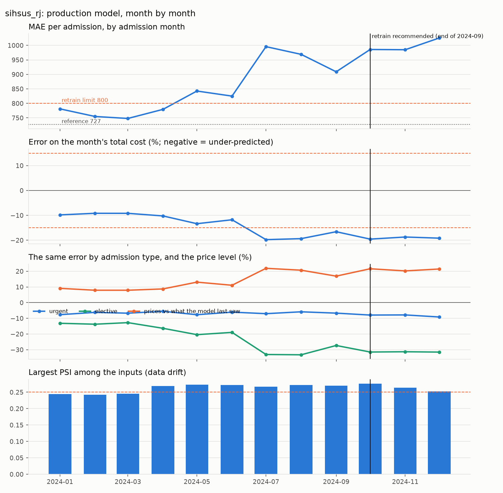

# Model card: `cost-sihsus_rj` version 3

Predicts, at the moment of admission, how much the SUS will pay for a hospital admission in the state of Rio de
Janeiro. It is the model currently in `production` in the MLflow registry. All numbers below come from the reports in
[`reports/sihsus_rj/`](reports/sihsus_rj/) and can be regenerated with the commands in the [README](README.md).

It gives **two numbers for every admission**, because one number cannot do both jobs on a skewed cost (the 10% most
expensive admissions take 57% of the money):

- the **typical cost**: what this admission should cost. It is the number closest to each admission.
- the **expected cost**: the number to add up. Summed over many admissions it comes closest to what is paid.

## Model details

| | |
|---|---|
| Type | Two gradient-boosted tree models (LightGBM, regression), registered as one version |
| Typical cost | Least squares on log(cost), returned to reais with Duan's smearing factor; 255 leaves per tree, 324 trees |
| Expected cost | Tweedie objective (predicts the mean directly); 63 leaves per tree, 303 trees |
| Common settings | Learning rate 0.1, seed 42, trees chosen by early stopping on 2022, the admission date as an input |
| Trained on | 3,606,614 admissions from 2018-01-01 to 2022-12-31 (training + validation windows, refitted after the search) |
| Chosen by | Among 16 settings measured on 2022: for the typical cost, the lowest MAE with a monthly-total error at or under 15%; for the expected cost, the lowest monthly-total error ([train_valid.md](reports/sihsus_rj/train_valid.md)) |
| Alternatives tried | Random forest and CatBoost on the same 2022 validation year: 5–6% worse per admission ([families_valid.md](reports/sihsus_rj/families_valid.md)). An average of the two settings above: 0.6% better per admission and 2.4 points better on the month's total than the typical cost alone ([blend_valid.md](reports/sihsus_rj/blend_valid.md)); serving both numbers was preferred to averaging them. One model per procedure group: 1.8% better per admission, 1.5 points worse on the month's total, not adopted ([segments_valid.md](reports/sihsus_rj/segments_valid.md)). The recent billed price of each procedure as an input: no gain per admission, not adopted ([recent_price_valid.md](reports/sihsus_rj/recent_price_valid.md)). Retraining on only the last 4, 12 or 24 billed months instead of all of them: worse per admission ([base_window_valid.md](reports/sihsus_rj/base_window_valid.md)). A tabular foundation model (TabPFN-2, open weights) reading 10,000 recent admissions plus statistics of each code: a tie per admission and 2.34 points better on the month's total on a sample of 30,000 validation admissions, but it needs a GPU and was picked among four variants on that sample; not adopted, to be confirmed on a fresh year ([foundation_valid.md](reports/sihsus_rj/foundation_valid.md)) |
| Promoted by | The gate on 2023 ([test.md](reports/sihsus_rj/test.md)); see "How many times the test year was looked at" below |
| Packaging | MLflow pyfunc that takes the raw admission columns and builds its own features, so callers cannot build them differently |
| Served by | `costmodel score` (a month in batch) and `costmodel serve` (`POST /predict`); both return `typical_cost` and `expected_cost` |

**Inputs**, all known when the patient is admitted ([DATA_CONTRACT.md](DATA_CONTRACT.md)): admission date, age, sex,
main diagnosis (ICD-10), requested procedure (SIGTAP code), admission type (elective or urgent), hospital, municipality
of residence, bed specialty. The model derives coarser groups from the codes (ICD-10 category and chapter, procedure
group and subgroup), the month of year, and the admission date as a number of months. The last one lets the trees
apply the most recent price level to new admissions.

**What it relies on** (share of the trees' gain). Typical cost: requested procedure 48%, diagnosis category 21%,
procedure subgroup 13%, hospital 11%, everything else under 5% each. Expected cost: diagnosis category 31%, requested
procedure 21%, hospital 20%, procedure subgroup 16%, diagnosis chapter 6%, everything else under 5% each.

**Output:** two amounts in reais per admission, `typical_cost` and `expected_cost`.

## Intended use

- **Forecasting money, not cases.** Summing the **expected cost** of a month's admissions estimates what those
  admissions will cost months before the bills arrive (SUS hospitals bill up to about 5 months later). This is the use
  the gate and the monitor measure ("error on the month's total").
- **A first estimate per admission**, for planning and for prioritising which admissions to look at: the **typical
  cost**, with an error of about R$ 780 per admission on 2023 (see below).
- **A reference implementation.** The same pipeline can be trained on another payer's own admissions (see the README).
  This model itself applies only to SUS admissions in Rio de Janeiro.

Do not add up typical costs to forecast a total (they come out about 11% low on 2023), and do not read the expected
cost as the likely cost of one admission (on average it is further from each admission's cost).

## Out of scope: do not use it to

- **Decide anything about a patient's care**: authorising, denying, delaying or prioritising an admission or a
  treatment. The model predicts a reimbursement, not a clinical need.
- **Price or select people**: premiums, eligibility or any decision about an individual.
- **Judge or rank hospitals.** The hospital is an input, so the model learns each hospital's typical billing. That
  says nothing about its efficiency or quality, and a hospital with a sicker case mix will simply look "expensive".
- **Flag a bill as wrong or fraudulent.** A large gap between the bill and the prediction is expected for the most
  expensive admissions (see "Errors on the most expensive admissions").
- **Estimate what an admission costs the hospital.** The target is what the SUS paid (`VAL_TOT`, the reimbursement),
  which can be far from the real cost of care.
- **Predict private-plan, other-state or post-2024 costs without retraining.** Codes, prices and mix differ, and the
  model is already almost 20% low on the totals of late 2024 (see "Monitoring").

## Data

Public SIH/SUS hospital admission files (RD), state of Rio de Janeiro, downloaded from DATASUS with SHA-256 checksums
([`data/checksums/sihsus.json`](data/checksums/sihsus.json)). No raw data is stored in the repository.

- **Admissions:** 5,385,538 from 2018 to 2024, after these rules: only regular AIHs (`IDENT = 1`; type 5 are monthly
  continuation bills of long stays, not new admissions), one row per AIH, amount paid above zero, and dated by
  **admission**, not by billing month. Billing months up to 2025-06 are read so that late bills of 2024 admissions are
  included.
- **Target:** `VAL_TOT`, the total amount paid for the AIH. Median R$ 671, mean R$ 1,583; the 10% most expensive
  admissions take 57% of the money.
- **Windows, by admission date:** train 2018–2021 (2,819,848), validation 2022 (786,766), test 2023 (877,760),
  monitoring 2024 (901,164).
- **Excluded from the inputs** because they are known only during or after the stay: length of stay, ICU days,
  performed procedure, death, discharge, secondary diagnoses, complexity and the reason for discharge. A test fails
  the build if any of them reaches the features.

## Performance on the test year (2023)

All models were fitted on the same data (2018–2022) and scored on the same 877,760 admissions. In the model's row,
the error per admission is the typical cost's and the error on the month's total (and the bias) is the expected
cost's: each number is judged by the metric it is for.

| Model | MAE (R$) | Error on the month's total | Bias | MAE, top 10% most expensive |
|---|---:|---:|---:|---:|
| **This model** | **778.62** | **6.53%** | −6.64% | **4,724.83** |
| Median by procedure × age band × admission type | 872.80 | 40.81% | −40.89% | 6,191.20 |
| Median by procedure | 886.29 | 41.53% | −41.61% | 6,283.98 |
| Linear regression on log(cost) | 937.81 | 12.89% | −12.89% | 5,848.08 |
| Mean by procedure × age band × admission type | 972.10 | 13.44% | −13.57% | 5,376.14 |
| Mean by procedure | 1,003.53 | 13.50% | −13.63% | 5,546.33 |
| Global mean | 1,579.64 | 7.15% | −7.36% | 7,763.69 |

"Error on the month's total" is the mean, over the 12 months, of |predicted total − paid total| / paid total.

Each of the model's two numbers on every metric:

| | MAE (R$) | Error on the month's total | Bias | MAE, top 10% most expensive |
|---|---:|---:|---:|---:|
| Typical cost | **778.62** | 11.32% | −11.42% | 4,724.83 |
| Expected cost | 819.17 | **6.53%** | −6.64% | **4,471.24** |

- The typical cost has the lowest error per admission, 10.8% below the strongest baseline (the business-rule median
  by procedure, age and admission type).
- The expected cost has the lowest error on the month's total, at R$ 40.55 more per admission than the typical cost.
- **A global mean is almost as good on the month's total (7.15% against 6.53%).** Prices rose while the mix moved to
  cheaper procedures; a global mean ignores both, and the two mistakes partly cancel. Anyone who needs only the
  monthly total of all admissions should still compare against a simple average. For any smaller total it is not
  enough (next table).
- Both numbers under-predict 2023 (the expected cost by 6.64%): prices kept rising after the training data ended.

### Is it worth it over a plain average?

Error on the totals of each month, for groups of different sizes ([skill_test.md](reports/sihsus_rj/skill_test.md)).
The error is weighted by money, so the first row is close to, but not the same as, the monthly-total error above.

| Totals of each month, for | How many totals | Plain average | Mean per procedure | This model | Model's error is smaller by |
|---|---:|---:|---:|---:|---:|
| All admissions | 12 | 7.36% | 13.63% | 6.64% | 10% |
| Each admission type | 36 | 17.61% | 13.63% | 6.65% | 62% |
| Each procedure group | 48 | 14.90% | 13.68% | 6.66% | 55% |
| Each bed specialty | 138 | 28.11% | 15.08% | 6.83% | 76% |
| Each diagnosis chapter | 255 | 39.07% | 13.94% | 7.18% | 82% |
| Each procedure subgroup | 360 | 41.57% | 13.84% | 7.64% | 82% |
| Each hospital | 2,885 | 49.25% | 29.58% | 11.16% | 77% |
| *Each admission (MAE, R$)* | 877,760 | *1,579.64* | *1,003.53* | *778.62* | *51%* |

The model adds little to the total of all admissions and a great deal to every smaller total. This table was
computed after the model was promoted; nothing was chosen with it.

### How many times the test year was looked at

Twice. Version 2 of this model gave one number, the typical cost above, and was scored on 2023 once: MAE 778.62,
month's-total error 11.32%. The expected cost was added afterwards, with its setting chosen on 2022 only, and 2023
was scored again to judge it. The typical cost is the same model as in version 2 and its numbers did not change. The
expected cost's numbers therefore come from a year that had already been seen, and the gate's rule for replacing a
model in production was written for this change (see the README). A year not used for any choice (2025) is the next
check.

### A year no choice was made on (2025)

The test year was looked at twice, so one more year was read once, by settings and criteria committed beforehand
([report](reports/sihsus_rj_2025/fresh_year.md)). The same two settings, fitted on the admissions whose costs were
known when 2025 began, priced its 919,818 admissions with an error of R$ 1,029.00 per admission (typical cost) and
2.79% on the month's total (expected cost). The two numbers did what each is for. Against a plain average the error
on totals was 42% to 83% smaller at every level. Per admission, though, the typical cost was only 0.6% better than a
table of medians per procedure, age band and admission type, less than the 2% the gate asks for: per admission, this
model should not be assumed to beat a careful lookup table. Version 3 itself, never retrained since 2022, would have
missed the 2025 month's total by 17.55%.

### Error by segment (MAE of the typical cost, R$)

| Segment | Admissions | Mean paid | This model | Best baseline |
|---|---:|---:|---:|---:|
| Age < 1 | 45,381 | 2,307.35 | 1,496.71 | 1,708.15 |
| Age 1–4 | 33,080 | 963.31 | 414.24 | **402.42** |
| Age 5–14 | 45,669 | 922.22 | 402.22 | 404.24 |
| Age 15–29 | 175,620 | 884.67 | 323.88 | 334.13 |
| Age 30–44 | 151,432 | 1,173.50 | 499.36 | 542.16 |
| Age 45–59 | 145,430 | 1,913.02 | 892.68 | 1,024.90 |
| Age 60–74 | 184,356 | 2,355.87 | 1,120.41 | 1,297.82 |
| Age 75+ | 96,792 | 2,185.72 | 1,183.72 | 1,319.58 |
| Female | 506,388 | 1,420.73 | 648.51 | 717.16 |
| Male | 371,372 | 1,929.10 | 956.04 | 1,085.02 |
| Elective | 265,323 | 2,186.54 | 926.10 | 1,119.74 |
| Urgent | 610,135 | 1,394.76 | 713.40 | 764.37 |
| Other admission type | 2,302 | 2,050.30 | 1,069.11 | 1,150.10 |

"Best baseline" is the median by procedure × age band × admission type. The model is better in every segment except
children aged 1–4, where the two are within 3%. Errors are larger where admissions cost more (babies, older adults,
men, elective surgery); relative to the mean paid, the gap between groups is much smaller. This table is a check of
where the model errs, not a fairness audit.

### Errors on the most expensive admissions

Grouping 2023 admissions by decile of what was actually paid:

| Decile of amount paid | Mean paid (R$) | Mean typical cost (R$) | Mean expected cost (R$) |
|---:|---:|---:|---:|
| 1 (cheapest) | 138.16 | 238.93 | 284.64 |
| 5 | 629.21 | 837.38 | 853.01 |
| 9 | 2,251.76 | 2,332.75 | 2,543.66 |
| 10 (most expensive) | 9,279.05 | 5,724.60 | 5,917.61 |

Like any model of this kind, it pulls extremes towards the middle: it over-predicts cheap admissions and
under-predicts the most expensive ones by about 38% on average (36% for the expected cost). What happens during an
expensive stay (complications, ICU) is not known at admission. Individual predictions for high-cost cases should be
read as "this is likely to be expensive", not as an amount.

## Monitoring (2024, simulated production)

The model priced every month of 2024 as if it were live ([monitor.md](reports/sihsus_rj/monitor.md)). A month is
judged only 3 months after it ends, when 98.7% of admissions and 95.4% of the money have been billed (measured on
2018–2021). The MAE below is the typical cost's; every total, and its error, is the expected cost's.

- **It under-predicts throughout 2024:** the month's total is 9–10% low from January to April, 12–13% in May and
  June, and 17–20% from July to December. The MAE steps up from about 850 to over 1,000 in July.
- **The cause is price, and the July step is in elective surgery.** Against the prices the model last saw (mean per
  procedure in 2022, same mix), what was paid is 7.91–9.12% higher from January to April, 11.08–13.07% in May and June
  and 16.90–21.89% from July. The error on urgent admissions stays between −5.50% and −9.14% all year; on elective
  admissions it goes from −12.74% to −16.35% (January to April) to −27.31% to −33.25% (July to December). The median
  paid for cataract surgery (SIGTAP 0405050372) is R$ 772 in every month up to June and R$ 3,858 from July. The rule
  behind this change was not identified.
- **The retrain rule fires at the end of November 2024.** July and August were the first two months in a row to break
  the limits (MAE more than 10% above the test MAE, or the month's total off by more than 15%), and their costs were
  known only in November. With version 2, whose single number was further off on totals, the rule fired at the end of
  September: a better number for totals also means a later alarm.
- **Input drift did not warn about it.** The largest PSI among the inputs stays between 0.24 and 0.28 all year, with no
  change when the error jumps, and the PSI of the predicted cost stays around 0.01. Admissions looked the same; what
  changed was the price paid for them (concept drift). Only the error, known after billing, shows it.

**Retraining.** The monitor recommends; a person decides and retrains, and the new model must pass the same gate. A
replay of 2024 under three policies, using only data known at each moment
([replay.md](reports/sihsus_rj/replay.md)):

| Policy | MAE (R$) | Error on the month's total | Retrained models put in use |
|---|---:|---:|---|
| Never retrain | 904.69 | 14.71% | none |
| Retrain when the rule fires (all data / last 24 months) | 898.72 / 898.55 | 13.46% / 13.47% | 1, from December |
| Try to retrain every month (all data / last 24 months) | 898.11 / 903.10 | 8.55% / 8.57% | 2, from February and September |

The rule reacts late to a steady price rise; retraining whenever new billed data exist cuts the error on the month's
total from 15% to 9%. The retrain rule was fixed before looking at 2024 and has not been changed to fit these
results. The gate's rule against the model in use is the new one (see "How many times the test year was looked
at"), so this replay is a description of 2024 under that rule, not an independent test of it.

## Known limitations

- **Payment-rule changes are invisible until billed.** The July 2024 change in what is paid for elective surgery
  could not be learned from earlier data, and showed in no input. The monitor's price level and its breakdown by
  admission type show where such a change happened, three months later.
- **Systematic under-prediction when prices rise.** The time input carries the latest price level forward but cannot
  anticipate increases. Without retraining, the error grows month after month.
- **The expected cost was judged on a year already seen** (see "How many times the test year was looked at").
- **Requested procedure.** It is the strongest input and matches the performed procedure in 95.9% of admissions. The
  public files hold the AIH as billed, so it cannot be confirmed that this field was never amended after admission.
  If it was, the measured error is somewhat optimistic.
- **New or rare codes.** Procedures, diagnoses or hospitals seen 20 times or fewer in the training data are treated as
  unknown; the model then falls back on coarser groups (procedure subgroup, ICD-10 chapter).
- **Late feedback.** The error of a month is known only 3 months after it ends, so problems are detected at least that
  late.
- **Sex and age are inputs.** They are known at admission and help explain cost (stays of babies and older adults
  cost more). This is one more reason to keep to the intended uses above.
- **The serving API is for local or internal use**: no authentication, no rate limiting, one process. It binds to
  127.0.0.1 by default.
