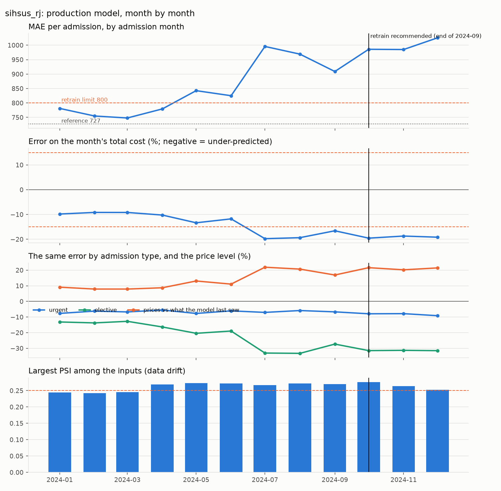
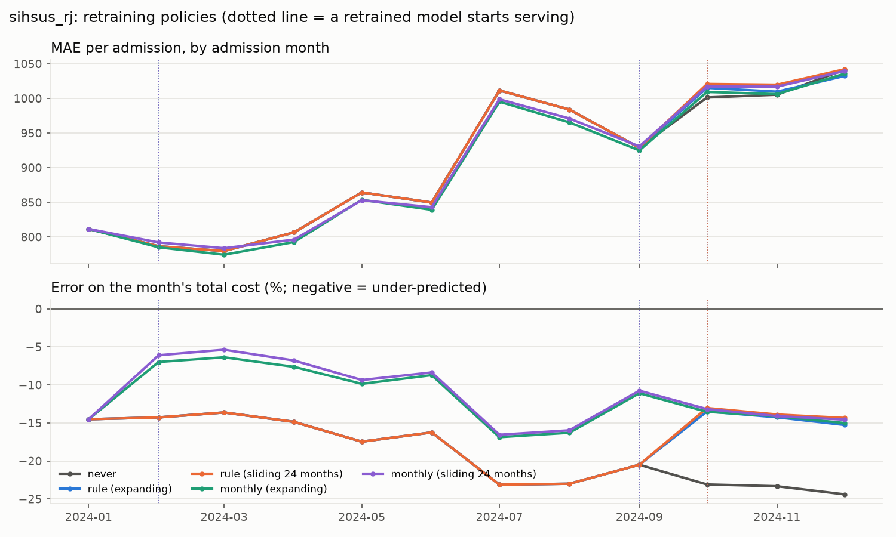

# hospital-cost-forecast

Predicts the cost of a hospital admission at the moment of admission, using public SUS data. Built like production:
honest baselines, explicit leakage controls, time-based validation, a registered model behind an API, and monthly
drift monitoring that shows when the model needs retraining.

The pipeline does not depend on SUS: it reads one canonical admissions table defined by a
[data contract](DATA_CONTRACT.md). Public SIH/SUS data (state of Rio de Janeiro, 2018–2024, 5.4 million admissions) is
the first source; a health plan can fill the same table with its own claims and run the same commands.

**[Results page](https://mauryneto.github.io/hospital-cost-forecast/)**: the numbers below as interactive charts.
**[Explorer](https://mauryneto.github.io/hospital-cost-forecast/explore.html)**: the model in production against what was paid, month by month, for all admissions
or for one admission type, procedure group, bed specialty or hospital.



## Results

**Two numbers for every admission.** Costs are skewed (the 10% most expensive admissions take 57% of the money), so
the number closest to each admission is not the one that adds up to the month's total. The model gives both: the
**typical cost** (what this admission should cost) and the **expected cost** (the number to add up).

**Test year (2023).** Every model was fitted on 2018–2022 and scored on the same 877,760 admissions. In the model's
row, the error per admission is the typical cost's and the error on the month's total is the expected cost's.

| Model | MAE per admission (R$) | Error on the month's total | Bias |
|---|---:|---:|---:|
| **LightGBM (in production)** | **778.62** | **6.53%** | −6.64% |
| Median by procedure × age band × admission type (business rule) | 872.80 | 40.81% | −40.89% |
| Median by procedure | 886.29 | 41.53% | −41.61% |
| Linear regression on log(cost) | 937.81 | 12.89% | −12.89% |
| Mean by procedure × age band × admission type | 972.10 | 13.44% | −13.57% |
| Mean by procedure | 1,003.53 | 13.50% | −13.63% |
| Global mean | 1,579.64 | 7.15% | −7.36% |

| The model's two numbers | MAE per admission (R$) | Error on the month's total | Bias |
|---|---:|---:|---:|
| Typical cost | **778.62** | 11.32% | −11.42% |
| Expected cost | 819.17 | **6.53%** | −6.64% |

- The typical cost beats the strongest baseline by 10.8% per admission. The expected cost has the lowest error on the
  month's total, at R$ 41 more per admission.
- **A global mean is almost as good on the month's total (7.15%).** It is in the table because it is the honest
  comparison for anyone who only needs that one total. The next table shows where it stops being enough.
- Medians show the same split from the other side: they win per admission and miss the month's total by 40%. That is
  why the gate checks both metrics.
- **The test year was looked at twice.** The first version gave one number, the typical cost, and was scored on 2023
  once. The expected cost was added later, chosen on 2022 only, and 2023 was scored again to judge it. The typical
  cost's numbers are unchanged; the expected cost's come from a year already seen
  ([model card](MODEL_CARD.md#how-many-times-the-test-year-was-looked-at)).

**Is the model worth it over a plain average?** ([skill_test.md](reports/sihsus_rj/skill_test.md)). A plain average
gives every admission the same amount. Error on the totals of each month, for groups of different sizes, on the same
test year (weighted by money, so the first row is close to, but not the same as, the 7.15% and 6.53% above):

| Totals of each month, for | Plain average | Mean per procedure | This model | Model's error is smaller by |
|---|---:|---:|---:|---:|
| All admissions | 7.36% | 13.63% | 6.64% | 10% |
| Each admission type | 17.61% | 13.63% | 6.65% | 62% |
| Each procedure group | 14.90% | 13.68% | 6.66% | 55% |
| Each bed specialty | 28.11% | 15.08% | 6.83% | 76% |
| Each hospital | 49.25% | 29.58% | 11.16% | 77% |
| *Each admission (MAE, R$)* | *1,579.64* | *1,003.53* | *778.62* | *51%* |

- For the total of all admissions, a plain average is nearly enough, and the reason is not skill. Prices rose (the
  mean per procedure, which keeps the mix right, is 13.63% low) while the mix moved to cheaper procedures; the plain
  average ignores both and the two mistakes partly cancel. Had the mix moved the other way, they would have added up.
- For any total smaller than everything, the plain average is off by 15% to 49% and the model by 7% to 11%. A payer
  budgets by hospital, by specialty and by case, which is where the model earns its place.

**A year no choice was made on (2025).** Every choice here was made on 2022 and judged on 2023 and 2024, which
ended up being looked at more than once. 2025 was read once, by settings, questions and criteria committed before any
of its costs was read ([the protocol](DECISIONS.md#the-2025-check-written-before-looking),
[the report](reports/sihsus_rj_2025/fresh_year.md)). The model is the two settings of version 3, fitted on the
5,169,905 admissions whose costs were known when 2025 began; it prices the 919,818 admissions of the year with an
error of R$ 1,029.00 per admission and 2.79% on the month's total.

| Written beforehand | Verdict | What 2025 said |
|---|---|---|
| The typical cost is closer to each admission, the expected cost to the month's total | Confirmed | R$ 1,029.00 against 1,049.47 per admission; 2.79% against 5.37% on the month's total |
| The model beats the best simple rule by the gate's margin, and a plain average at every level | **Not confirmed** | Per admission it is 0.6% better than the median per procedure, age band and admission type (1,035.18); the gate asks for 2%. On totals the model's error is 42% to 83% smaller than a plain average's at every level |
| Idea from 2022: recent months weigh more (better on the month's total) | **Contradicted** | Worse on both: 3.05 more per admission, 0.89 points more on the month's total |
| Idea from 2022: a typical-cost model of its own for surgical admissions (better per admission) | Confirmed | 40.68 less per admission over all admissions (988.33 against 1,029.00) |
| Idea from 2022: TabPFN-2 with code statistics (better on the month's total, not worse per admission) | **Contradicted** | On 30,000 admissions: 62.74 less per admission, but 38.92% off on the month's total against 4.42% |
| Trying to retrain every month beats waiting for the rule on the month's total | Confirmed | 2.12% against 2.79%, with one retrained model put in use |

A difference counts as confirmed or contradicted only when its 95% interval leaves zero out. What the year adds to
the verdicts:

- **On totals the model did better than in the test year**: 2.79% on the month's total (6.53% in 2023), drifting from
  2.87% high in January to 7.01% low in December.
- **Per admission, its lead over a table of medians went from 10.8% in 2023 to 0.6%.** The medians miss the month's
  total by 44.29%, so they are no substitute, but the gate's rule against baselines would not have let this model
  in. One likely reason, not tested: the typical cost is not a median. It is the log model's prediction scaled up (by
  17% in version 3) so that it adds up better, and with costs this skewed, whatever predicts lower gets closer to
  each admission.
- **The same effect shows in the model in production, never retrained since 2022**: it would have been closer to each
  admission (960.25) while missing the month's total by 17.55%. The error per admission alone is a poor judge of a
  model when prices have moved.
- **The gate blocked 18 of the 21 retrained candidates in the replay.** All 18 were 6% to 13% better per admission on
  the two months they were judged on and were refused for being worse on those months' total, which the model in use
  happened to hit within 3%. The rule fired from August on and none of its retrains was used. "Not worse on the
  other number", judged on two months, is too strict.
- **TabPFN-2's two numbers went opposite ways.** Its median was closer to each admission than the model's typical
  cost, and its mean overshot the month's total in every month of the year. A diagnostic run afterwards on the same
  admissions points at how the mean is taken out of it (an average of exp() over a hundred levels of the distribution
  it predicts for log(cost)): 98% of the paid amounts fell below the level it gave as its 95%, and the few levels
  above that one carry almost all of the excess. On 2022 the same recipe was 8.50% low. That is a finding about this
  way of reading an expected cost from the model, not a verdict on foundation models.
- **Nothing was adopted.** The model in production is still version 3. What to do with each finding is in the
  roadmap and in [DECISIONS.md](DECISIONS.md).

**Should the typical cost be a median? (2022)** The typical cost is the log model's prediction scaled up so that it
adds up better, which the expected cost now does. The 2025 check suggested that this factor costs accuracy per
admission, so the same setting was fitted on the training window and read four ways on the validation year
([typical_valid.md](reports/sihsus_rj/typical_valid.md)):

| The typical cost as | MAE (R$) | Against today's (95% interval) | MAE, other 90% | MAE, top 10% | If it were added up | Lead over the best baseline |
|---|---:|---:|---:|---:|---:|---:|
| Today's: scaled by the factor (1.157) | 792.15 | | 313.72 | 5,098.02 | 14.98% low | 6.7% |
| The same model without the factor | 747.38 | −44.77 (−45.58 to −43.90) | 251.26 | 5,212.42 | 26.50% low | 11.9% |
| A median model, fitted on log(cost) | 733.45 | −58.69 (−60.37 to −56.91) | 219.72 | 5,356.99 | 31.71% low | 13.6% |
| A median model, fitted on the cost | 746.11 | −46.04 (−48.00 to −44.01) | 234.37 | 5,351.75 | 31.17% low | 12.1% |

- **The factor costs 5.7% per admission.** Leaving it out needs no new model: the same 324 trees, a different last
  step. The lead over the best baseline (a table of medians) goes from 6.7% to 11.9%.
- **A model fitted to give the median goes further, 7.4%,** but it used all 2,000 trees it was allowed (six times
  the size of today's) and had not stopped improving.
- **One average hides two kinds of admission.** The 10% most expensive admissions received 57.3% of the money and
  carry 64.4% of today's error per admission. They are real bills, and which admission will be one of them is not
  known at admission, so they are not left out; the error is read in two bands. On the other 90% the error goes
  from 313.72 to 251.26 without the factor (19.9% lower) and to 219.72 with the median model. The bands are cut by
  what was paid, known only afterwards.
- **What it gives up:** a median is 2% to 5% further from the 10% most expensive admissions, and added up it would
  fall 26% to 32% short. The model does not add up the typical cost; the expected cost is for that.
- **Not adopted.** This is the validation year, where choices are made. 2025 has been read and cannot confirm it; the
  first half of 2026 can.

**A tabular foundation model on the validation year (2022).** A foundation model is not trained on this data: it
reads labelled admissions as context and prices the others in one pass. TabPFN-2, the TabPFN checkpoint with open
weights, reads 10,000 rows; the training window has 2.8 million. Every row below is scored on the same 30,000
admissions, drawn at random from 2022, so the numbers compare with each other and not with the other tables
([foundation_valid.md](reports/sihsus_rj/foundation_valid.md)):

| Model | What it learns from | MAE per admission (R$) | Error on the month's total | MAE against the first row (95% interval) |
|---|---|---:|---:|---:|
| LightGBM, as in production | all 2,819,848 training admissions | 787.13 | 11.69% | |
| LightGBM | 10,000 admissions of the last 12 months | 965.15 | 19.69% | +178.01 (+161.43 to +197.58) |
| LightGBM | the same, plus code statistics | 882.57 | 19.35% | +95.43 (+80.42 to +110.67) |
| TabPFN-2 | the same 10,000 admissions | 877.30 | 10.84% | +90.16 (+76.19 to +103.73) |
| TabPFN-2 | the same, plus code statistics | 792.38 | 9.35% | +5.25 (-6.00 to +16.93) |

"Code statistics" are three more inputs: the mean log(cost) of the admission's procedure, diagnosis and hospital over
the training admissions outside the context, a way of telling a model that reads few rows what the other rows say.

- With the same rows and the same inputs, TabPFN-2 is 9% to 10% better per admission than LightGBM. Reading examples
  beats fitting trees when there are few rows.
- With 10,000 rows alone it is 11.5% worse than the model in production. The rows it cannot read matter.
- With the code statistics it ties with the model in production per admission (the interval contains zero) and
  misses the month's total by 2.34 points less (interval: 1.30 to 3.04).
- **Not adopted.** This is one sample of one year, one draw of the context, and the best of four TabPFN variants
  picked on that same sample. It needs a GPU and took 10 to 13 minutes to price 30,000 admissions, against seconds.
  And a new candidate would have to face a test year that has already been looked at twice. It stays as the first
  thing to confirm on a fresh year.
- The newer TabPFN checkpoints read up to a million rows, which is the limit that hurt here. They need an account
  and a non-commercial licence that also covers the model's outputs, so they were not used.

**Why LightGBM: other model families on the validation year (2022).** Same training admissions, same inputs, same
two metrics ([families_valid.md](reports/sihsus_rj/families_valid.md)):

| Model family | Setting | MAE per admission (R$) | Error on the month's total | Time to fit |
|---|---|---:|---:|---:|
| **LightGBM (gradient boosting)** | least squares on log(cost); chosen among 16 settings | **792.15** | 14.98% | 75 s |
| Random forest | on log(cost) | 835.15 | 18.34% | 220 s |
| CatBoost | Tweedie | 837.15 | 11.28% | 40 min |
| CatBoost | least squares on log(cost) | 838.64 | 15.76% | 30 min |
| Random forest | on the cost | 841.43 | **9.09%** | 150 s |

- No other family came close per admission: all four are 5–6% worse than LightGBM.
- The error on the month's total follows what the model is fitted on more than the family. Models fitted on the cost
  itself miss the total by less (9–11%) and each admission by more, and LightGBM does the same when given a Tweedie
  objective with the same inputs (10.69% to 11.46% at an MAE of 800 to 811). The random forest on the cost has the lowest total error of all.
- The comparison is not even: LightGBM's row is the best of 16 settings and each other family got two, and CatBoost
  was still improving when it reached its limit of 1,000 trees. More tuning would narrow the gap; at 30 to 40 minutes
  per fit against 75 seconds, it was not pursued.
- Nothing was promoted from this comparison, and the test year was not looked at again.

**Averaging two settings of LightGBM** ([blend_valid.md](reports/sihsus_rj/blend_valid.md)). The setting chosen for the
error per admission (least squares on log(cost)) and the one with the lowest error on the month's total in the search
(Tweedie), fitted as in the search and averaged, on the same validation year:

| Share of the Tweedie model | MAE per admission (R$) | Error on the month's total |
|---|---:|---:|
| 0% (the chosen setting alone) | 792.15 | 14.98% |
| 25% | **787.00** | 13.78% |
| 50% | 787.47 | 12.58% |
| 75% | 793.89 | 11.52% |
| 100% (the Tweedie setting alone) | 807.86 | **10.69%** |

Half and half is better than the chosen setting on both metrics: by 0.6% per admission and by 2.4 points on the
month's total. This trade-off, which the next three experiments showed again, is what led to serving two numbers
instead of one: the model now gives the first setting as the typical cost and the second as the expected cost, each
used for what it is best at, rather than one average that is a little better at both.

**One model for every admission, or one per group?** ([segments_valid.md](reports/sihsus_rj/segments_valid.md)). The
chosen setting fitted once per group, with only that group's admissions, and measured on the whole validation year:

| | Models | MAE per admission (R$) | Error on the month's total |
|---|---:|---:|---:|
| **One model for every admission** | 1 | 792.15 | **14.98%** |
| One model per admission type (elective, urgent) | 2 | 791.17 | 15.28% |
| One model per procedure group (clinical, surgical) | 2 | **777.98** | 16.49% |

- Splitting by admission type changes nothing: the single model already separates elective from urgent.
- Splitting by procedure group is 1.8% better per admission and 1.5 points worse on the month's total, above the
  gate's 15% ceiling, so the single model stays. The gain is all in surgery: its own model has an MAE of R$ 575
  against R$ 628 (8% better), while under-predicting surgery's total by 9% instead of 2%. For clinical admissions
  the group's own model is slightly worse per admission (R$ 899 against R$ 886).
- Groups with fewer than 20,000 training admissions (diagnostic procedures, transplants) kept the single model.

**Telling the model what each procedure has been costing lately**
([recent_price_valid.md](reports/sihsus_rj/recent_price_valid.md)). One more input: the mean paid for the same
procedure over the last billed months. An admission only uses bills from four months before its own month or earlier,
which is what is known by then. The model is not retrained along the year; only this input moves.

| | Window | MAE per admission (R$) | Error on the month's total |
|---|---|---:|---:|
| **The candidate as it is** | | **792.15** | 14.98% |
| Recent price as one more input | last 3 billed months | 803.94 | 14.10% |
| Recent price as one more input | last 12 billed months | 795.56 | 14.36% |
| Cost predicted relative to the recent price | last 3 billed months | 822.00 | **10.92%** |
| Cost predicted relative to the recent price | last 12 billed months | 808.39 | 11.76% |

It did not help per admission: every variant is worse there, by 0.4% to 3.8%. Predicting the cost relative to the
recent price does cut the error on the month's total, to about the level LightGBM's Tweedie setting reaches without
any new input (10.69% at an MAE of 807.86). So on a year of steady price rises it adds nothing that a different
objective does not already give, and it would cost a table of recent prices kept up to date for serving. What it
was built for, a sudden change like July 2024, is not in this year and was not tested.

**How much billed history should each retrain use?**
([base_window_valid.md](reports/sihsus_rj/base_window_valid.md)). Prices move every few months, so a short, recent
history is a natural idea. Here the model is fitted again before every quarter of 2022, with only the admission months
already billed by then, and prices that quarter. Every variant is retrained four times; only its history differs.

| History given to each retrain | Admissions per fit | MAE per admission (R$) | Error on the month's total |
|---|---:|---:|---:|
| Last 4 billed months | 252,641 | 818.56 | 14.20% |
| Last 12 billed months | 742,852 | 800.17 | 13.49% |
| Last 24 billed months | 1,410,114 | 796.58 | 13.03% |
| **Every billed month** | 2,917,840 | **788.65** | 13.39% |
| Every billed month, recent months weigh more | 2,917,840 | 796.15 | **12.37%** |
| *For reference: fitted once, never retrained* | | *792.15* | *14.98%* |

- More history is better per admission, in every quarter. Four months is 3.8% worse than everything: with thousands of
  procedure codes, a short history has too few examples of most of them.
- A short history is not fresher either. Bills take months to arrive, so "the last 4 billed months" are already 4 to
  7 months old when the quarter is priced.
- Weighing recent months more gives the lowest error on the month's total, at 1% more per admission.
- Retraining every quarter on everything billed beats the model fitted once on both metrics, which agrees with the
  2024 replay.
- This is SUS, where the price table moves slowly. A payer whose contract prices are renegotiated every quarter, and
  whose bills arrive sooner, may get a different answer from the same command.

**Monitoring (2024, simulated production).** The expected cost under-predicts the month's total by 9–10% early in
2024 and by 17–20% from July. The retrain rule fires at the end of November, once July and August, the first two
months in a row out of bounds, have been billed. Input drift (PSI) stayed flat while the error jumped: the admissions
looked the same, but the prices paid for them went up.

**What happened in July 2024: a price change in elective surgery.** The monitor compares what was paid with what the
same admissions would cost at the prices the model last saw (mean per procedure in 2022, same mix):

| | January–April | May–June | July–December |
|---|---:|---:|---:|
| Prices against the level the model last saw | +7.91% to +9.12% | +11.08% to +13.07% | +16.90% to +21.89% |
| Error on the month's total, urgent admissions | −5.50% to −7.67% | −6.04% to −7.70% | −5.84% to −9.14% |
| Error on the month's total, elective admissions | −12.74% to −16.35% | −18.96% to −20.41% | −27.31% to −33.25% |

Urgent admissions were paid as before; elective ones were not. The median paid for cataract surgery
(phacoemulsification, SIGTAP 0405050372) was R$ 772 in every month up to June and R$ 3,858 from July; for laparoscopic
cholecystectomy (0407030034) it went from R$ 1,057 to between R$ 1,397 and R$ 2,026. A model trained on earlier prices
cannot know this, and no input drift shows it. The rule behind the change was not identified; a payment complement
for elective surgery is the likely kind of cause.

**Retraining policies, replayed over 2024** with only the data known at each moment:

| Policy | MAE (R$) | Error on the month's total |
|---|---:|---:|
| Never retrain | 904.69 | 14.71% |
| Retrain when the rule fires | 898.72 | 13.46% |
| Try to retrain every month (each candidate still gated) | 898.11 | 8.55% |

Retrains use all data known so far; using only the last 24 months gives nearly the same numbers. By the rule, one
retrained model enters, in December; trying every month, two enter, in February and September.



Details: [model card](MODEL_CARD.md) (intended use, segments, limitations), and the generated reports in
[`reports/sihsus_rj/`](reports/sihsus_rj/).

## Quickstart

Needs [uv](https://docs.astral.sh/uv/) and about 1.5 GB of disk. From a clone of this repository:

```bash
uv sync
uv run costmodel run      # download SIH/SUS RJ (~400 MB, checksummed), validate, train, gate, monitor
uv run costmodel serve    # API on http://127.0.0.1:8000/docs
```

`costmodel run` takes about half an hour on a desktop PC. The same with Docker, writing everything to `./docker-work`:

```bash
docker compose run --rm costmodel run
```

```bash
docker compose up api
```

### Commands

| Command | What it does |
|---|---|
| `costmodel data` | Ingest the configured source, check it against the contract, save the admissions table |
| `costmodel eda` / `baselines` | Exploratory report; fit and compare the baselines on validation |
| `costmodel train` | Search the candidate's settings on validation, refit, register it in MLflow as `staging` |
| `costmodel evaluate` | Score `staging` once on test, run the gate, promote it to `production` if it passes |
| `costmodel monitor` | Score the monitoring months: PSI per input, error once billed, where the error comes from (admission type, price level), and the retrain rule |
| `costmodel replay` | What-if of the retraining policies over the monitoring months (slow: it retrains) |
| `costmodel score --month 2024-03` | Batch: price a month of admissions with `production` |
| `costmodel serve` | HTTP API: `POST /predict` (a typical and an expected cost per admission), `GET /health` |
| `costmodel families` | Compare other model families (random forest, CatBoost) with the chosen candidate on validation; CatBoost needs `uv sync --extra families` |
| `costmodel blend` | Average the candidate's best per-admission and best month's-total settings, on validation |
| `costmodel segments` | One model for every admission, or one per admission type / procedure group? On validation |
| `costmodel recent-price` | Does the model do better when given each procedure's recent billed price? On validation |
| `costmodel typical` | Should the typical cost be a median? The same setting, four ways to give the number, on validation |
| `costmodel foundation` | A tabular foundation model (TabPFN-2) against the candidate, on a sample of validation; needs `uv sync --extra foundation` and a GPU |
| `costmodel base-window` | How much billed history should each retrain use? Retrained every 3 months, on validation |
| `costmodel skill` | Is the production model worth it over a plain average? Totals by hospital, specialty and more, on test |
| `costmodel fresh` | A year no choice was made on, scored once by the settings in `[fresh]`: `--config configs/sihsus_rj_2025.toml` (run `costmodel data` with it first) |
| `costmodel explore` | The production model group by group and month by month (hospital, specialty and more): the data of the explorer page |
| `costmodel site` | The static pages with the results ([`docs/index.html`](docs/index.html) and, after `explore`, [`docs/explore.html`](docs/explore.html)), built from the reports |
| `costmodel run` | `data`, `train`, `evaluate`, `monitor`, in order, stopping at the first failure |
| `costmodel validate file.csv` | Check a file against the data contract and list every problem |

Every command takes `--config configs/<dataset>.toml` (default: the SIH/SUS demo). Runs are manual; nothing is
scheduled. Experiments and the model registry can be browsed with
`uv run mlflow ui --backend-store-uri sqlite:///mlflow.db --host 127.0.0.1 --port 5000`.

### Use your own admissions

1. Fill [`templates/admissions_template.csv`](templates/admissions_template.csv) following
   [DATA_CONTRACT.md](DATA_CONTRACT.md), and check it: `uv run costmodel validate my_admissions.csv`.
2. Copy [`configs/example_file.toml`](configs/example_file.toml), point it at the file and set the windows.
3. `uv run costmodel run --config configs/my_plan.toml`.

To try this path without real data, `costmodel synthetic` writes made-up plan admissions (TUSS codes) and
[`configs/synthetic_plan.toml`](configs/synthetic_plan.toml) runs the pipeline on them. A model trained on SUS prices
does not transfer to a private plan; the pipeline does.

## How it works

```
 SIH/SUS (DATASUS) ─► adapter ─┐
                               ├─► admissions table ─► contract ─► time split ─► features ─► baselines + LightGBM
 your CSV / Parquet ───────────┘     (canonical)        (pandera)                (allow-list)          │
                                                                                                       ▼
        monitor: PSI now, error after billing ◄── API + batch scoring ◄── gate ◄── MLflow registry ('staging')
                       │                                                    │
                       └─► "retraining recommended" ─► a person retrains ───┘ (same gate)
```

More in [ARCHITECTURE.md](ARCHITECTURE.md).

## Design decisions

- **A data contract between the source and the model.** Everything after ingestion reads one table, checked by
  pandera before anything is trained; a bad file fails with a list of every problem. SIH/SUS is one adapter, so other
  data needs a CSV, not code.
- **Prediction at admission, enforced in code.** Features are built from an allow-list of columns known at admission.
  Length of stay, ICU days, performed procedure, death and discharge stay in the table for analysis, and a test fails
  the build if any of them changes the features.
- **Time-based validation.** Train 2018–2021, choose on 2022, test on 2023 (each candidate scored there once), then
  replay 2024 as production. A
  random split would mix future prices into training and hide the drift that matters most here.
- **A strong business-rule baseline.** The median by procedure, age band and admission type is what an analyst would
  build by hand; the requested procedure alone explains 65% of the variance of log(cost). The model has to beat it.
- **Two metrics, and a number for each.** MAE per admission, and the error on each month's total, because money is
  counted in totals. Five experiments on 2022 kept showing that what helps one hurts the other, so the model gives a
  typical cost, chosen for the first, and an expected cost, chosen for the second, registered as one version.
- **A gate that judges each number by its own metric.** Against the best baseline: an MAE at least 2% lower and a
  month's-total error no worse. Against the model in production: at least one of the two better by its margin (2% for
  the MAE, 10% for the month's total) and the other not worse. And never a month's-total error above 15%. If the
  candidate fails and nothing is in production, the best baseline is put in production instead.
- **Time as an input.** Trees cannot extrapolate a price trend. Giving the model the admission date as a number made
  it apply the latest price level to new admissions, cutting the validation error on the month's total from 14–17% to
  10–15% at the same MAE.
- **Billing delay is part of monitoring.** Costs are known only once billed: 3 months after the admission month covers
  98.7% of admissions but 95.4% of the money, because expensive stays bill later. A month is judged only then;
  judging earlier would understate the error.
- **The monitor recommends; a person retrains.** Retraining changes what is in production, so the trigger is human
  and the new model goes through the same gate. The replay of 2024 suggests the retrain rule reacts late; it was
  fixed before looking at 2024 and is left unchanged rather than fitted to it. The gate's rule against the model in
  production did change, when the model started to give two numbers; [DECISIONS.md](DECISIONS.md) says why.
- **The registered model builds its own features.** It takes raw contract columns, so the API and the batch job
  cannot prepare inputs differently from training. Both load one exact version and report it with every prediction;
  rolling back is moving the `production` alias.
- **SIH/SUS cleaning rules,** each checked on the real files: only regular AIHs (`IDENT = 1`; type 5 are monthly
  continuation bills of long stays), one row per AIH, amount paid above zero, dated by admission rather than billing
  month, and billing files read until 2025-06 so that late bills of 2024 are complete.

## Limitations

- **SUS reimbursement, not cost of care,** and for Rio de Janeiro only. The target is what the SUS paid.
- **It under-predicts when prices rise:** the expected cost by 7% on 2023 and up to 20% in late 2024 without
  retraining (the typical cost, which is not meant to be added up, by more). A change
  in payment rules, like the one for elective surgery in July 2024, is seen only after the bills arrive.
- **Individual predictions for the most expensive admissions are low:** the top decile is under-predicted by about
  38% on average (36% by the expected cost). What happens during the stay is not known at admission.
- **The expected cost was judged on a year already seen,** and the gate's rule for replacing a model was written for
  it. A year not used for any choice is still missing.
- **The requested procedure is assumed to be as known at admission.** Public files hold the AIH as billed; if the
  field was amended later, the measured error is somewhat optimistic.
- **Not for decisions about patients, people or hospitals.** See the [model card](MODEL_CARD.md) for what it must not
  be used for.
- **The API is for local or internal use:** no authentication or rate limiting.

## Roadmap

Not done yet, in the order planned:

1. **A newer tabular foundation model, if its licence is accepted.** TabPFN-2, with open weights, was compared
   (see Results): reading 10,000 admissions and statistics of the codes, it ties with the model in production per
   admission and does better on the month's total, on a sample of validation. The newer checkpoints read up to a
   million rows but need an account and a non-commercial licence. The author's call. On 2025, TabPFN-2 was closer to
   each admission than the model and far off on the month's total, so its expected cost needs work before anything.
2. **When the money goes out.** The model prices an admission in the month the patient is admitted, but bills arrive
   over the following months (about a third of the money in the same month, a third one month later, the rest after
   that, the expensive bills last). Spreading each month's expected cost over the months it will be billed in gives a
   cash-flow forecast.
3. **The official price table as an input.** The SUS publishes the table price of every procedure, and it is known
   before the admission. It may let the model follow a published price change at once instead of months later. The
   July 2024 change looks like a complement paid outside the table, so it may not be caught; finding the rule behind
   it belongs here.
4. **Other states,** to see how much of the model is specific to Rio de Janeiro.
5. **The patient's history** (earlier admissions). It usually helps a cost model a great deal, but the public SUS files
   do not identify the patient across admissions; this is for a payer's own data.

What the 2025 check left open:

- **A typical cost that is a median.** The typical cost is scaled up to add up better, and in 2025 a table of medians
  nearly tied with it per admission. Tried on the validation year (see Results): without the factor the error per
  admission is 5.7% lower, with a median model 7.4% lower. Still to be confirmed on a period not read yet.
- **The gate's rule for a retrained model.** Judged on two months, "not worse on the other number" refused 18 of 21
  retrains that were clearly better per admission. The margin, the number of months, or both need rethinking.
- **A typical-cost model of its own for surgery.** Better on 2022 and confirmed on 2025; not adopted yet.
- **A period not read yet.** 2025 has now been read. The next clean check is the first half of 2026, once its bills
  are complete.

Decided against: **prediction ranges** ("between X and Y"). Whoever uses this wants a value to work with, and the
model already says which value is for what (the typical cost and the expected cost). And a **neural network with
embeddings**, the family furthest from trees, whose gain on this kind of table is unlikely.

## How this was built

The code was written with [Claude Code](https://claude.com/claude-code), an AI coding assistant, and every commit
says so. The direction, the questions along the way and what stayed in were the author's.
[DECISIONS.md](DECISIONS.md) lists the decisions that shaped the project and where each one came from.

## Project

Python 3.12, uv, LightGBM, pandera, MLflow (SQLite), FastAPI (CatBoost is optional, for the family comparison); the results page is plain HTML, CSS and JavaScript. Lint with ruff, tests with pytest; CI runs a secret scan
(gitleaks), lint and the test suite, both directly and inside the Docker image. Only public data is used; raw data is never
committed, only its checksums.

MIT License.
