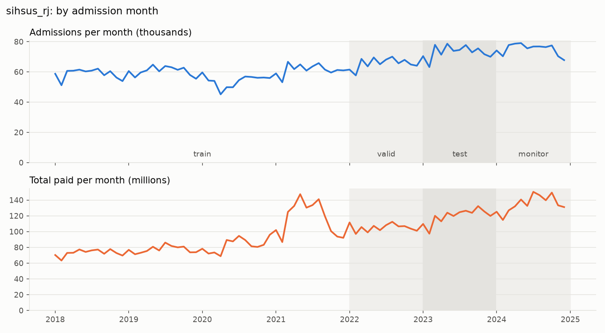
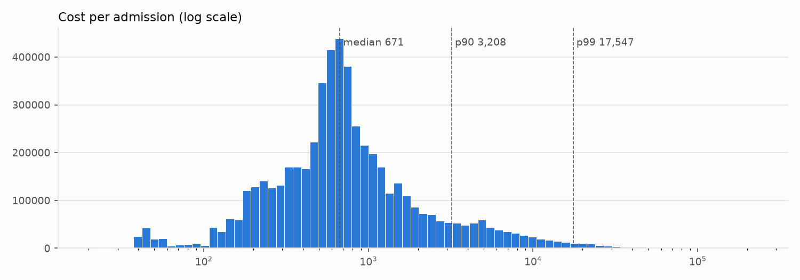

# Exploratory analysis (sihsus_rj)

Generated by `costmodel eda --config configs/sihsus_rj.toml`.

- Admissions: **5,385,538**; by year: 2018: 704,497, 2019: 727,106, 2020: 649,147, 2021: 739,098, 2022: 786,766, 2023: 877,760, 2024: 901,164
- Cost per admission: median 671, mean 1,583, p99 17,547.
- The 10% most expensive admissions account for **57%** of all money paid.
- The requested procedure is the performed one in **95.9%** of admissions.

Share of the variance of log(cost) explained by each column alone (in-sample, training window):

| Column | Variance explained |
|---|---|
| requested procedure | 65.3% |
| main diagnosis | 44.7% |
| hospital | 16.7% |
| admission type | 0.9% |

