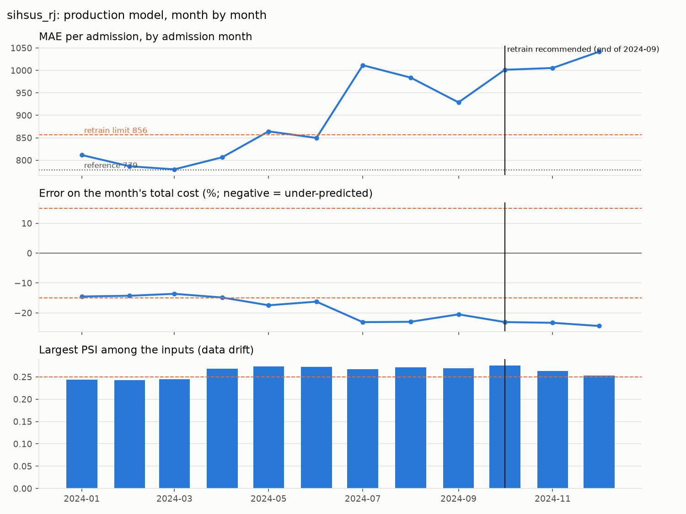

# Monitoring the production model (sihsus_rj)

Generated by `costmodel monitor --config configs/sihsus_rj.toml`. Model: `cost-sihsus_rj` version 2, reference MAE 778.62 (its error on the test window).

Retrain rule: 2 mature months in a row with MAE above 10% over the reference (856.48) or a monthly-total error beyond 15%. A month is mature 3 months after it ends (costs are known only once billed).

**Retraining recommended at the end of 2024-09.**

## Month by month

| month   |     n |     MAE |   total error % |   max PSI | most drifted        | out of bounds                                               |
|:--------|------:|--------:|----------------:|----------:|:--------------------|:------------------------------------------------------------|
| 2024-01 | 74155 |  811.59 |          -14.51 |      0.24 | requested_procedure | -                                                           |
| 2024-02 | 70341 |  786.56 |          -14.27 |      0.24 | requested_procedure | -                                                           |
| 2024-03 | 77764 |  779.72 |          -13.62 |      0.25 | requested_procedure | -                                                           |
| 2024-04 | 78687 |  806.63 |          -14.86 |      0.27 | diagnosis_icd10     | -                                                           |
| 2024-05 | 79045 |  864.28 |          -17.46 |      0.27 | diagnosis_icd10     | MAE 864.28 > 856.48; monthly total error -17.5% beyond 15%  |
| 2024-06 | 75564 |  849.67 |          -16.24 |      0.27 | diagnosis_icd10     | monthly total error -16.2% beyond 15%                       |
| 2024-07 | 76772 | 1011.55 |          -23.12 |      0.27 | diagnosis_icd10     | MAE 1011.55 > 856.48; monthly total error -23.1% beyond 15% |
| 2024-08 | 76809 |  984.01 |          -23.00 |      0.27 | diagnosis_icd10     | MAE 984.01 > 856.48; monthly total error -23.0% beyond 15%  |
| 2024-09 | 76389 |  928.83 |          -20.50 |      0.27 | requested_procedure | MAE 928.83 > 856.48; monthly total error -20.5% beyond 15%  |
| 2024-10 | 77484 | 1001.41 |          -23.09 |      0.28 | requested_procedure | MAE 1001.41 > 856.48; monthly total error -23.1% beyond 15% |
| 2024-11 | 70378 | 1005.39 |          -23.33 |      0.26 | requested_procedure | MAE 1005.39 > 856.48; monthly total error -23.3% beyond 15% |
| 2024-12 | 67776 | 1041.52 |          -24.40 |      0.25 | requested_procedure | MAE 1041.52 > 856.48; monthly total error -24.4% beyond 15% |

## Data drift: PSI per input against the training data (stable < 0.1, shift > 0.25)

Known as soon as the month's admissions arrive, months before their costs.

|         |   requested_procedure |   diagnosis_icd10 |   diagnosis_category |   diagnosis_chapter |   procedure_prefix4 |   bed_specialty |   admission_type |   provider_id |   procedure_prefix2 |   age_years |   predicted cost |   residence_area |   sex |   procedure_code_system |
|:--------|----------------------:|------------------:|---------------------:|--------------------:|--------------------:|----------------:|-----------------:|--------------:|--------------------:|------------:|-----------------:|-----------------:|------:|------------------------:|
| 2024-01 |                  0.24 |              0.22 |                 0.21 |                0.13 |                0.05 |            0.05 |             0.03 |          0.02 |                0.01 |        0.01 |             0.01 |             0.01 |  0.00 |                    0.00 |
| 2024-02 |                  0.24 |              0.18 |                 0.17 |                0.13 |                0.05 |            0.05 |             0.02 |          0.03 |                0.01 |        0.01 |             0.01 |             0.01 |  0.00 |                    0.00 |
| 2024-03 |                  0.24 |              0.20 |                 0.18 |                0.14 |                0.05 |            0.06 |             0.03 |          0.03 |                0.01 |        0.01 |             0.01 |             0.01 |  0.00 |                    0.00 |
| 2024-04 |                  0.25 |              0.27 |                 0.21 |                0.14 |                0.06 |            0.06 |             0.04 |          0.03 |                0.01 |        0.01 |             0.01 |             0.01 |  0.00 |                    0.00 |
| 2024-05 |                  0.26 |              0.27 |                 0.23 |                0.15 |                0.06 |            0.07 |             0.04 |          0.03 |                0.01 |        0.01 |             0.01 |             0.01 |  0.00 |                    0.00 |
| 2024-06 |                  0.26 |              0.27 |                 0.26 |                0.15 |                0.07 |            0.07 |             0.04 |          0.02 |                0.01 |        0.01 |             0.01 |             0.01 |  0.00 |                    0.00 |
| 2024-07 |                  0.26 |              0.27 |                 0.24 |                0.14 |                0.07 |            0.07 |             0.05 |          0.01 |                0.02 |        0.01 |             0.01 |             0.01 |  0.00 |                    0.00 |
| 2024-08 |                  0.27 |              0.27 |                 0.23 |                0.14 |                0.08 |            0.08 |             0.05 |          0.02 |                0.02 |        0.02 |             0.01 |             0.01 |  0.00 |                    0.00 |
| 2024-09 |                  0.27 |              0.25 |                 0.23 |                0.15 |                0.09 |            0.08 |             0.06 |          0.02 |                0.02 |        0.01 |             0.01 |             0.01 |  0.00 |                    0.00 |
| 2024-10 |                  0.28 |              0.25 |                 0.23 |                0.15 |                0.10 |            0.08 |             0.06 |          0.02 |                0.03 |        0.02 |             0.01 |             0.01 |  0.00 |                    0.00 |
| 2024-11 |                  0.26 |              0.22 |                 0.20 |                0.13 |                0.07 |            0.07 |             0.04 |          0.02 |                0.01 |        0.01 |             0.01 |             0.01 |  0.00 |                    0.00 |
| 2024-12 |                  0.25 |              0.21 |                 0.19 |                0.12 |                0.05 |            0.05 |             0.02 |          0.01 |                0.01 |        0.01 |             0.01 |             0.01 |  0.00 |                    0.00 |

## When each decision could be made

| decision_month   | mature_through   | retrain   | reason                                                                                                                                                                       |
|:-----------------|:-----------------|:----------|:-----------------------------------------------------------------------------------------------------------------------------------------------------------------------------|
| 2024-01          | 2023-10          | False     | only 0 mature month(s); the rule needs 2                                                                                                                                     |
| 2024-02          | 2023-11          | False     | only 0 mature month(s); the rule needs 2                                                                                                                                     |
| 2024-03          | 2023-12          | False     | only 0 mature month(s); the rule needs 2                                                                                                                                     |
| 2024-04          | 2024-01          | False     | only 1 mature month(s); the rule needs 2                                                                                                                                     |
| 2024-05          | 2024-02          | False     | within bounds                                                                                                                                                                |
| 2024-06          | 2024-03          | False     | within bounds                                                                                                                                                                |
| 2024-07          | 2024-04          | False     | within bounds                                                                                                                                                                |
| 2024-08          | 2024-05          | False     | within bounds                                                                                                                                                                |
| 2024-09          | 2024-06          | True      | 2 months in a row out of bounds (2024-05: MAE 864.28 > 856.48, monthly total error -17.5% beyond 15%; 2024-06: monthly total error -16.2% beyond 15%)                        |
| 2024-10          | 2024-07          | True      | 2 months in a row out of bounds (2024-06: monthly total error -16.2% beyond 15%; 2024-07: MAE 1011.55 > 856.48, monthly total error -23.1% beyond 15%)                       |
| 2024-11          | 2024-08          | True      | 2 months in a row out of bounds (2024-07: MAE 1011.55 > 856.48, monthly total error -23.1% beyond 15%; 2024-08: MAE 984.01 > 856.48, monthly total error -23.0% beyond 15%)  |
| 2024-12          | 2024-09          | True      | 2 months in a row out of bounds (2024-08: MAE 984.01 > 856.48, monthly total error -23.0% beyond 15%; 2024-09: MAE 928.83 > 856.48, monthly total error -20.5% beyond 15%)   |
| 2025-01          | 2024-10          | True      | 2 months in a row out of bounds (2024-09: MAE 928.83 > 856.48, monthly total error -20.5% beyond 15%; 2024-10: MAE 1001.41 > 856.48, monthly total error -23.1% beyond 15%)  |
| 2025-02          | 2024-11          | True      | 2 months in a row out of bounds (2024-10: MAE 1001.41 > 856.48, monthly total error -23.1% beyond 15%; 2024-11: MAE 1005.39 > 856.48, monthly total error -23.3% beyond 15%) |
| 2025-03          | 2024-12          | True      | 2 months in a row out of bounds (2024-11: MAE 1005.39 > 856.48, monthly total error -23.3% beyond 15%; 2024-12: MAE 1041.52 > 856.48, monthly total error -24.4% beyond 15%) |
