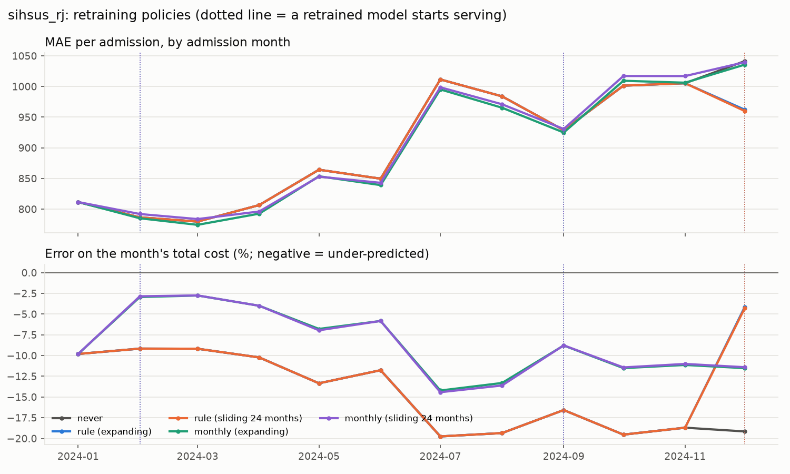

# Retraining policies, replayed over the monitoring window (sihsus_rj)

Generated by `costmodel replay --config configs/sihsus_rj.toml`. Starting model: `cost-sihsus_rj` version 3 (reference MAE 778.62). Costs become known 3 months after the admission month; retrained models use only data known at the time, and each must pass the gate on the last 2 known months before it is used.

| policy                      |    MAE |   monthly total error % |   bias % |   retrain attempts |   waits (no new data) |   models put in use |
|:----------------------------|-------:|------------------------:|---------:|-------------------:|----------------------:|--------------------:|
| never                       | 904.69 |                   14.71 |   -14.96 |                  0 |                     0 |                   0 |
| rule (expanding)            | 898.72 |                   13.46 |   -13.75 |                  1 |                     0 |                   1 |
| rule (sliding 24 months)    | 898.55 |                   13.47 |   -13.76 |                  1 |                     0 |                   1 |
| monthly (expanding)         | 898.11 |                    8.55 |    -8.75 |                  7 |                     4 |                   2 |
| monthly (sliding 24 months) | 903.10 |                    8.57 |    -8.78 |                  7 |                     4 |                   2 |

## MAE by month

|         |   never |   rule (expanding) |   rule (sliding 24 months) |   monthly (expanding) |   monthly (sliding 24 months) |
|:--------|--------:|-------------------:|---------------------------:|----------------------:|------------------------------:|
| 2024-01 |  811.59 |             811.59 |                     811.59 |                811.59 |                        811.59 |
| 2024-02 |  786.56 |             786.56 |                     786.56 |                785.09 |                        792.04 |
| 2024-03 |  779.72 |             779.72 |                     779.72 |                774.39 |                        783.78 |
| 2024-04 |  806.63 |             806.63 |                     806.63 |                792.64 |                        796.17 |
| 2024-05 |  864.28 |             864.28 |                     864.28 |                853.62 |                        853.00 |
| 2024-06 |  849.67 |             849.67 |                     849.67 |                839.20 |                        842.92 |
| 2024-07 | 1011.55 |            1011.55 |                    1011.55 |                995.31 |                        998.76 |
| 2024-08 |  984.01 |             984.01 |                     984.01 |                965.42 |                        971.07 |
| 2024-09 |  928.83 |             928.83 |                     928.83 |                925.00 |                        930.80 |
| 2024-10 | 1001.41 |            1001.41 |                    1001.41 |               1009.39 |                       1017.21 |
| 2024-11 | 1005.39 |            1005.39 |                    1005.39 |               1006.26 |                       1017.08 |
| 2024-12 | 1041.52 |             962.15 |                     959.96 |               1035.77 |                       1039.70 |

## Error on the month's total (%)

|         |   never |   rule (expanding) |   rule (sliding 24 months) |   monthly (expanding) |   monthly (sliding 24 months) |
|:--------|--------:|-------------------:|---------------------------:|----------------------:|------------------------------:|
| 2024-01 |   -9.81 |              -9.81 |                      -9.81 |                 -9.81 |                         -9.81 |
| 2024-02 |   -9.16 |              -9.16 |                      -9.16 |                 -2.94 |                         -2.85 |
| 2024-03 |   -9.18 |              -9.18 |                      -9.18 |                 -2.76 |                         -2.75 |
| 2024-04 |  -10.23 |             -10.23 |                     -10.23 |                 -3.99 |                         -3.99 |
| 2024-05 |  -13.35 |             -13.35 |                     -13.35 |                 -6.79 |                         -6.95 |
| 2024-06 |  -11.77 |             -11.77 |                     -11.77 |                 -5.83 |                         -5.83 |
| 2024-07 |  -19.75 |             -19.75 |                     -19.75 |                -14.22 |                        -14.42 |
| 2024-08 |  -19.35 |             -19.35 |                     -19.35 |                -13.31 |                        -13.61 |
| 2024-09 |  -16.57 |             -16.57 |                     -16.57 |                 -8.79 |                         -8.77 |
| 2024-10 |  -19.54 |             -19.54 |                     -19.54 |                -11.51 |                        -11.43 |
| 2024-11 |  -18.70 |             -18.70 |                     -18.70 |                -11.13 |                        -11.01 |
| 2024-12 |  -19.15 |              -4.12 |                      -4.26 |                -11.52 |                        -11.40 |

## Retrain decisions: rule (expanding)

| decided   | why                                                                                                                                                                         | data through   |   candidate MAE |   in-use MAE | promoted   | serves from   |
|:----------|:----------------------------------------------------------------------------------------------------------------------------------------------------------------------------|:---------------|----------------:|-------------:|:-----------|:--------------|
| 2024-11   | 2 months in a row out of bounds (2024-07: MAE 1011.55 > 856.48, monthly total error -19.8% beyond 15%; 2024-08: MAE 984.01 > 856.48, monthly total error -19.4% beyond 15%) | 2024-08        |          964.95 |       997.77 | True       | 2024-12       |

## Retrain decisions: rule (sliding 24 months)

| decided   | why                                                                                                                                                                         | data through   |   candidate MAE |   in-use MAE | promoted   | serves from   |
|:----------|:----------------------------------------------------------------------------------------------------------------------------------------------------------------------------|:---------------|----------------:|-------------:|:-----------|:--------------|
| 2024-11   | 2 months in a row out of bounds (2024-07: MAE 1011.55 > 856.48, monthly total error -19.8% beyond 15%; 2024-08: MAE 984.01 > 856.48, monthly total error -19.4% beyond 15%) | 2024-08        |          965.62 |       997.77 | True       | 2024-12       |

## Retrain decisions: monthly (expanding)

| decided   | why       | data through   |   candidate MAE |   in-use MAE | promoted   | serves from   |
|:----------|:----------|:---------------|----------------:|-------------:|:-----------|:--------------|
| 2024-01   | scheduled | 2023-10        |          796.10 |       819.80 | True       | 2024-02       |
| 2024-04   | scheduled | 2024-01        |          805.16 |       814.37 | False      | -             |
| 2024-05   | scheduled | 2024-02        |          792.12 |       797.35 | False      | -             |
| 2024-06   | scheduled | 2024-03        |          771.85 |       779.47 | False      | -             |
| 2024-07   | scheduled | 2024-04        |          772.33 |       783.57 | False      | -             |
| 2024-08   | scheduled | 2024-05        |          804.65 |       823.20 | True       | 2024-09       |
| 2024-11   | scheduled | 2024-08        |          964.95 |       967.01 | False      | -             |

## Retrain decisions: monthly (sliding 24 months)

| decided   | why       | data through   |   candidate MAE |   in-use MAE | promoted   | serves from   |
|:----------|:----------|:---------------|----------------:|-------------:|:-----------|:--------------|
| 2024-01   | scheduled | 2023-10        |          801.40 |       819.80 | True       | 2024-02       |
| 2024-04   | scheduled | 2024-01        |          809.07 |       816.86 | False      | -             |
| 2024-05   | scheduled | 2024-02        |          796.95 |       801.83 | False      | -             |
| 2024-06   | scheduled | 2024-03        |          772.66 |       787.70 | False      | -             |
| 2024-07   | scheduled | 2024-04        |          774.88 |       790.01 | False      | -             |
| 2024-08   | scheduled | 2024-05        |          806.32 |       824.65 | True       | 2024-09       |
| 2024-11   | scheduled | 2024-08        |          965.62 |       969.73 | False      | -             |
